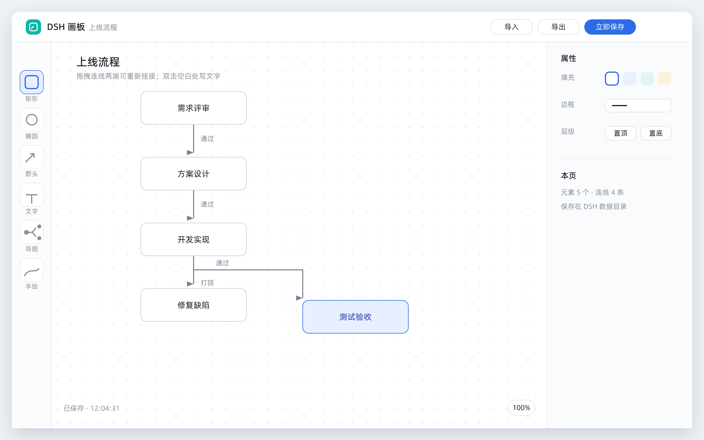
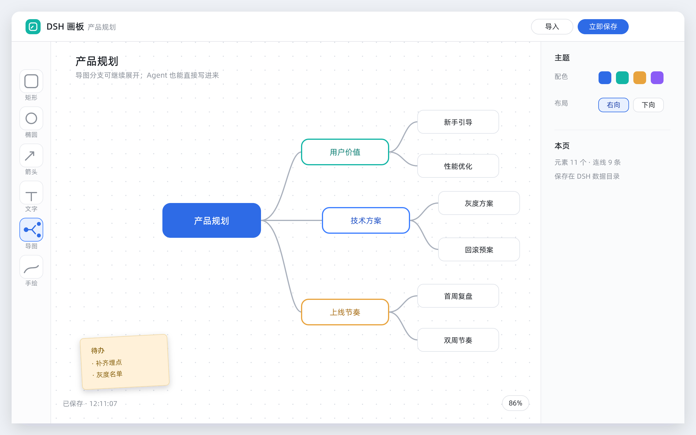

# DSH 画板工作台（DSHDrawWorkbench / `dsh-draw-workbench`）

给 DSH Desktop 用的白板工作台：在桌面端里画流程图、架构图、思维导图与手绘草图，
**文档保存在 DSH 数据目录**（不是浏览器缓存），并且**可以让会话里的 Agent 直接把图画到画板上**。

内嵌的白板应用来自开源项目 [Drawnix](https://github.com/plait-board/drawnix)（MIT），
其绘图能力完整保留；本工作台只接管「数据存到哪、开哪一块画板」。

仓库：<https://github.com/andoaidlaksldk/DSHDrawWorkbench>





## 功能

| 能力 | 说明 |
|---|---|
| 多画板文档 | 新建 / 打开 / 重命名 / 创建副本 / 删除，文档以 `.drawnix` 格式落在数据目录 |
| 自动保存 | 画布改动防抖回写服务端；页面隐藏/卸载时用 `sendBeacon` 补一次，尽量不丢改动 |
| 导入 / 导出 | 导出即标准 `.drawnix` 文件，可直接用白板的「打开文件」再打开，也可再导入回来 |
| Agent 工具 | `board_list` / `board_read` / `board_write` 三个工具进会话能力清单，用对话框就能让 Agent 画图 |
| 外部写入提示 | 画布之外的写入（例如 Agent 调 `board_write`）会在几秒内被发现并提示「重新载入」 |
| AI 协助停靠 | 画板本身不需要会话；需要 Agent 参与时点右上角「AI 协助」，会话区停靠在右侧 |
| 离线可用 | 不联网、不上报；上游的统计脚本在构建期已被移除 |

## 安装

装进 DSH Desktop 的 Harness 数据目录（官方 Desktop profile 由应用的进程内插件管理器托管）：

```powershell
pnpm pack                          # 产出 dsh-draw-workbench-1.0.0.tgz
node scripts/install-to-desktop.mjs --dry-run   # 先看计划
node scripts/install-to-desktop.mjs             # 按 7 处记录写入并物化代际
```

然后**完全退出并重新打开 DSH Desktop**，左侧工作台列表里会出现「DSH 画板」。

> **不要删除 `dsh-draw-workbench-<版本>.tgz`**：管理器按它记录安装来源，删掉后下次启动
> 会对账失败并把插件清掉（思维导图工作台踩过一次）。

## 数据与接口

数据目录：`%APPDATA%\dsh-desktop\harness\draw-workbench`（由 `cordis.patch.yml` 的
`dshHomePath('draw-workbench')` 决定）

```
draw-workbench/
  state.json              当前打开的文档、画布偏好设置
  documents/default.json  一块画板一个文件；data 字段就是标准 .drawnix 数据
```

HTTP 接口（同源，前缀 `/api/dsh-draw-workbench`）：

| 方法 | 路径 | 用途 |
|---|---|---|
| GET | `/health` | 自检：托管文件数、被跳过/被拒绝的路由、文档数 |
| GET | `/session` | 画布启动：当前文档 + 偏好设置 |
| POST | `/session/data` | 自动保存（只允许保存已存在的文档） |
| POST | `/session/preferences` | 语言等画布偏好 |
| GET / POST | `/documents` | 列表 / `create`、`open`、`rename`、`duplicate`、`import`、`delete` |
| GET | `/app/**` | 内嵌白板的静态产物（逐文件精确登记） |

## 让 Agent 画图

会话里直接说需求即可，例如「画一张上线流程图：需求评审 → 开发 → 上线」，Agent 会调用
`board_write`：

```json
{
  "title": "上线流程",
  "nodes": [{ "id": "a", "text": "需求评审", "shape": "rectangle" }, { "id": "b", "text": "开发" }],
  "edges": [{ "from": "a", "to": "b", "label": "通过" }]
}
```

不写坐标时工具会按边的方向**分层布局**（入度为 0 的节点在第一层），所以开箱就是排好的。
也可以直接传完整的 `.drawnix` 数据（带 `elements` 数组）做精确覆盖；
`mode: "append"` 把新图追加到已有内容下方而不覆盖。

`board_read` 读回的是**人能看懂的元素清单**（图形带文字、连线写成「A → B：标签」——
连线是按坐标反查两端图形的，因为工具画的线不做绑定）。

## 工程结构

```
dsh/index.js             服务端：静态托管 + 文档库 + Agent 工具（画板 ⇄ 元素 ⇄ 文本）
lib/client.js            面板：工具栏 + 画布 iframe + 多文档 + 外部写入提示 + 会话停靠
overlay/app.tsx          画布定制（唯一被改写的上游业务文件）：数据改走本插件接口
overlay/vite.config.ts   构建配置：相对 base（子路径托管必需）
overlay/index.html       宿主页：去掉统计脚本与绝对 base
app/                     内嵌白板的构建产物（由脚本生成，勿手改）
scripts/canvas-overlay.mjs  把 overlay 施加到上游源码并构建（--restore 可还原）
scripts/sync-app.mjs        产物 → app/：宿主页净化、文件名 ASCII 化、ESM 语法闸门
scripts/verify.mjs          确定性自检（包/服务端/数据模型/工具/客户端一致性）
scripts/smoke.mjs           HTTP 冒烟（真实网络 + 落盘校验）
scripts/check-package.mjs   打包校验（安装契约、必需文件、体积、可疑文件）
scripts/install-to-desktop.mjs  按 7 处记录装进 DSH Desktop
```

### 重建内嵌画布

```powershell
node scripts/canvas-overlay.mjs --build   # 施加 overlay 并构建上游（需先 npm ci drawnix）
node scripts/sync-app.mjs                 # 同步进 app/，过语法闸门
node scripts/verify.mjs && node scripts/smoke.mjs
```

`canvas-overlay.mjs --restore` 用 git 还原上游源码；除 `apps/web` 的三个文件外不碰上游任何文件。

## 已知限制（如实说明）

- **上游品牌未清理**：内嵌白板的界面仍显示 Drawnix 名称与图标（有意保留，见 `THIRD-PARTY-NOTICES.md`）；
  本工作台在 DSH 里的名称、描述与文档一律自称「DSH 画板」。
- **连线不绑定图形**：Agent 写出的连线是绝对坐标直箭头，拖动图形时线不会跟着走。
- **导出依赖浏览器下载**：导出走 `<a download>`；若桌面壳拦截下载，请用「立即保存」把内容落盘后再从数据目录取文件。
- **单用户单标签页**：没有做多端并发编辑合并；检测到外部写入时只提示重载，不自动合并。

## 许可

本工作台 MIT（见 `LICENSE`）；内嵌的 Drawnix 及其依赖的 MIT 署名与清单见
`THIRD-PARTY-NOTICES.md`。
